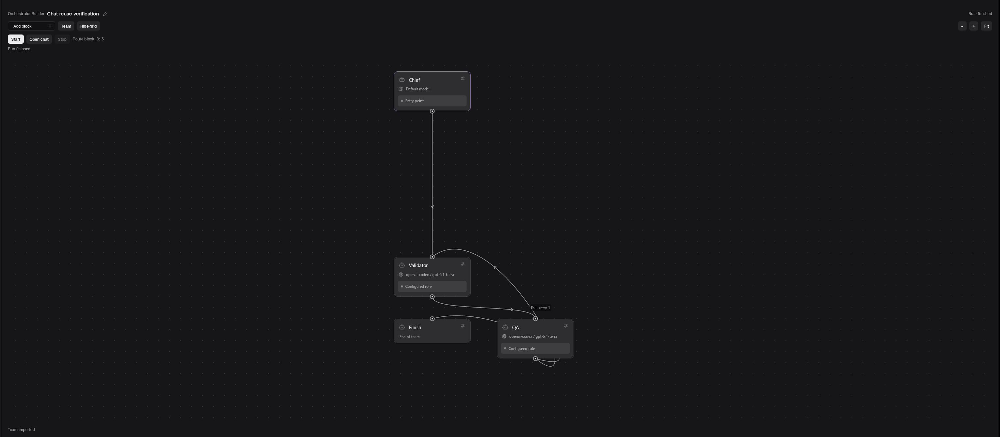

# Orchestrator Builder

A visual node editor for building and running agent teams in Zeron v3.

## Install

1. Download `orchestrator-builder-0.6.0.zeron-plugin` from the [latest release](https://github.com/Master0fFate/zeron-orchestration-builder/releases/latest).
2. In Zeron, open Settings → Plugins → Install and select the file.
3. Review and approve the requested permissions, then open Orchestrator Builder from the sidebar.

The plugin requires Zeron v3 and a configured agent. No changes to Zeron or separate helper are needed.

## Use

- New teams start with Chief → Planner → Worker → Validator → QA, with QA passing to Finish or returning to Validator on failure. Add Planner, Worker, Validator, Auditor, QA, Researcher or Finish blocks from the toolbar. Existing saved teams are not changed.
- Drag a block to move it. Drag an output dot to another block's input dot to connect them. Select a line to edit its condition or remove it. Conditions are Always, Pass and Fail; a Fail return needs a retry limit from 1 to 10. The limit counts failure returns across the entire run. Save connection applies settings; Remove connection deletes it. Incomplete drafts can be saved and checked later.
- Drag empty canvas space to pan, scroll to zoom at the pointer, and use Fit to frame the graph. The grid can be turned on or off from the toolbar.
- Select a block's settings icon to edit its name, icon, runtime, provider, model and role instructions. Choose Other agent to enter a custom runtime ID. Save the block to apply the edits.
- Custom icons are self-contained SVG files up to 16 KB. Zeron stores their contents with the team in the plugin's own storage; they are not separate files in the signed plugin folder.
- The team name is shown in the header and can be changed through its edit control. Open Team to create a new team or switch between saved teams. Names, positions, settings and connections are saved locally.
- In Team, export the current team to a JSON file or import a version 2 team JSON file as a separate saved team. Custom SVG icons are included in the file.
- Open Team for the name and checks. Checks flag missing inputs and outputs, invalid routes, unreachable blocks, missing role instructions, incomplete model choices, missing Finish blocks and unbounded cycles. A manually entered model ID is not checked against the catalog.

New role blocks start with editable default instructions. Custom instructions replace the default; Restore default puts it back. They are task text, not a system prompt. Chief is an entry point, not an agent turn: its settings are not used for runs, and it is not linked to the active chat. The plugin does not intercept the main chat's messages.

## Run a team

Select Start, enter a task, select an existing session on this device under Destination and confirm. The session supplies its device and, when present, project; check the IDs in the selection before starting. The plugin cannot verify whether the selected device is local with its current permissions. Remote destinations are unsupported: they may start a chat but cannot be relied on to deliver the tool call or terminal events to this runner. The selected session is not sent messages. If no valid local session is available, create one on this device first. The runner validates the destination and team before claiming the journal, and snapshots both for the run; later edits, team switches or session changes do not change it. The destination is stored in the run journal, including for interrupted runs. Acceptance starts asynchronous journal setup, not a guarantee that a chat was sent. The status and reason show progress or failure, and the route is a block ID in the run snapshot, not necessarily the team currently displayed.

The runner follows Chief's output and starts one chat per role block per run on the selected device and project, using that block's runtime and model when set. The first prompt starts with the block and team names to distinguish chat titles. Repeat visits reuse that block's chat and its context, including retries; separate blocks and separate runs have separate chats. It sends the task, role instructions and previous reports as task text. Each role is asked to call the Zeron `submit_report` tool once with its exact step reference (`nonce`) and a short human-readable `report`, then respond naturally. A role with Pass and Fail outputs also supplies `result` as `pass` or `fail`; an Always role omits it. If the role cannot complete its work, its report starts with the exact line `Status: blocked`; a review finding that work needs another pass is instead `result: fail`. Reports must be nonempty and at most 8192 bytes. The tool is exposed to Pi as `zeron_orchestrator_builder__submit_report`; names in other harnesses may differ. The final chat reply is not used for routing.

The tool records the report in SQLite before acknowledging it. A report received before a dispatch receipt remains pending under its caller's actual chat ID and is used only if that ID matches the receipt and its step nonce. The journal snapshots role chats, visits, dispatches and receipts, including message IDs and delivery when provided. Events arriving during dispatch are buffered until the receipt is saved. The runner advances only after its own turn starts and finishes successfully and the matching report and receipt are saved. Identical repeated submissions are accepted; conflicting submissions block. A completed turn without a matching report blocks rather than guessing or resending. Finish ends the run. Open chat opens the latest available run chat; it may belong to an earlier block, not the displayed route. The runner does not link the existing active chat or inherit its model.

Before reuse, the runner checks that the chat still exists on the selected device and project and its reported status is idle, absent or done. Working, waiting, input, failed and unknown statuses block. This check is advisory: status can lag and another person can start a turn between the check and delivery. Do not use or move run chats while the run is active. A turn's initial start may lack attribution in Zeron 0.3.7; its terminal event must still be attributed. Missing or foreign attribution and unexpected turn events block. The runner sends repeat visits with queue mode; if Zeron reports a queued delivery, the runner records the chat and message ID and blocks because it may still execute. Never blindly resend or create a replacement chat.

Use one Always output, or a Pass and a Fail output for a role. A Fail connection returning to a preceding block needs a retry limit of 1–10; each limit applies to that connection across the whole run. Exhausting it blocks the run. Every cycle must be bounded by such a return. These limits do not guarantee a successful result.

Stop prevents further dispatch but cannot cancel an in-flight turn or queued message. A stop, agent error or request for input, missing or invalid report, exhausted retry, ambiguous delivery, timeout, journal error or unexpected terminal event can block the run. A turn may still be running when the outcome is unknown. Some journal operations and listener registration have a 10-minute deadline; active agent turns do not. The runner does not resume automatically after interruption.

For a blocked or interrupted run, use Open chat when available to inspect the latest known chat, then Review / abandon. The chat can belong to an earlier block or be unavailable. Abandoning does not cancel in-flight or queued messages: inspect the chats and ensure any in-flight agent and queued messages are stopped or otherwise resolved before confirming. Confirmation requests an asynchronous journal update; watch the status and reason for the result. It does not retry or restart the run. Abandonment is refused while a journal claim, chat dispatch, receipt or report journal update is pending, and may be unavailable or fail if journal ownership is uncertain. In those cases the journal may remain locked and need manual review. An unknown delivery can remain unknown even after pending operations settle; check the chats before deciding whether to abandon.

## Development

Create a development plugin folder with `zeron plugin new`, copy the source files into it, and sign with `zeron plugin sign orchestrator-builder`. Zeron must be running. The plugin requests page, model-catalog, file-dialog, message send/read, session read, navigation and tools permissions.

## Limitations

The canvas describes the current editable team, not live block status or evidence that a workflow has run. Agent questions, automatic recovery and Chief inheritance are not implemented. Review roles run as agents; human review is for blocked, interrupted or unknown runs, not normal review steps. Manual abandonment does not stop agents, cancel queued messages or resolve unknown delivery. Prior reports are passed as untrusted context.

Zeron 0.3.7 may omit Pi's terminal reply; this handoff does not depend on it and requires no host patch, shell or native helper. The plugin remains subject to Zeron's loop guard. Keep Zeron open and the plugin running on this device for the entire run: without a service, tool calls and turn events are handled by the window. Closing or restarting it interrupts the run; it is not resumed or resent automatically. Remote runs are unsupported, and the plugin cannot identify remote selections with its current permissions. Agent tool availability and behavior depend on the selected harness and model.

## Design and source

The experimental `orchestrator-wallpaper` Zeron v3 template in `host/zeron-template` is intended to show Zeron's own new-chat wallpaper behind the builder using the same image or wallpaper plugin and effect settings. Its wallpaper rendering has not been verified. Without that template the builder uses the normal page background. The plugin cannot detect a wallpaper, so turn the grid off manually if desired. Cards use Zeron's frosted material and its transparency preference.

The starting team uses a simple plan, work and review sequence informed by [Anthropic's workflow guidance](https://www.anthropic.com/research/building-effective-agents) and [OpenAI's orchestration guidance](https://developers.openai.com/api/docs/guides/agents/orchestration). It is a starting diagram, not a guarantee of quality.

The plugin uses Zeron theme tokens and `@ds` components. Visual guidance comes from [unslop](https://github.com/heydamir/unslop) by Damir Sokolovsky, licensed CC BY 4.0. `zeron.luau` is the Zeron plugin SDK from [zeronsh/zeron](https://github.com/zeronsh/zeron), licensed under MIT; see `ZERON-LICENSE`.
